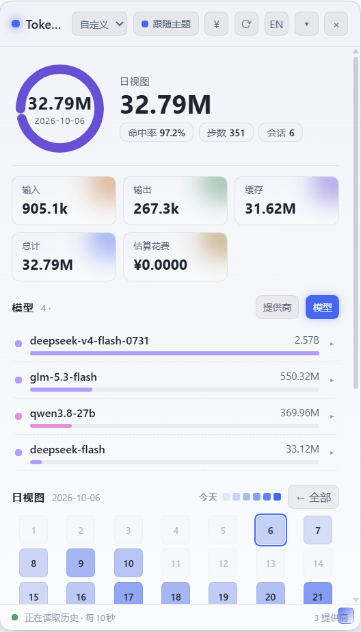
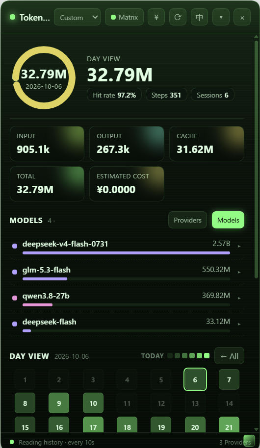
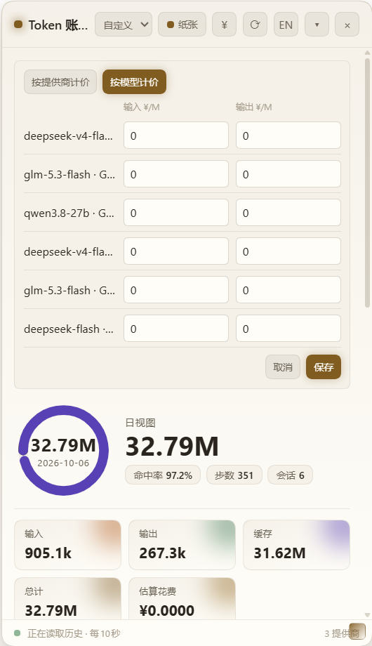
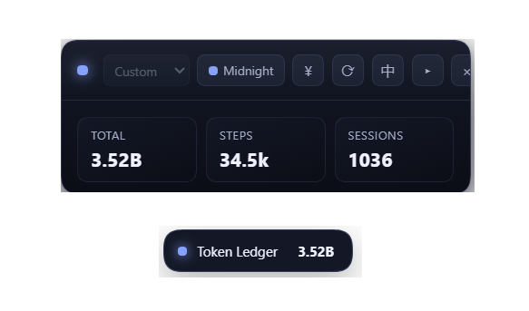

<h1> harness-ledger</h1>

<p align="left">中文 | <a href="README.md">English</a></p>

<p align="left">
  <a href="https://github.com/yuyuanjingxuan/harness-ledger/actions/workflows/check.yml"></a>
  <a href="LICENSE"></a>
  <a href="https://www.deepseek.com/harness/"></a>
  <a href="https://www.npmjs.com/package/harness-ledger"></a>
  <a href="https://www.npmjs.com/package/harness-ledger"></a>
</p>

DeepSeek Harness 的 token 用量与成本台账插件。它读取 Harness 会话中已经记录的用量数据，在一个可拖拽的浏览器面板里展示总量、按提供商和按模型的明细、月度热力图，以及会话级和请求级的记录。插件本身不调用任何模型，缓存存放在 dsh 用户数据区。

## 界面截图

<table>
  <tr>
    <td align="center"></td>
    <td align="center"></td>
  </tr>
  <tr>
    <td align="center">默认主题，中文界面</td>
    <td align="center">Matrix 主题，英文界面</td>
  </tr>
  <tr>
    <td align="center"></td>
    <td align="center"></td>
  </tr>
  <tr>
    <td align="center">按模型定价编辑器，纸张主题</td>
    <td align="center">紧凑视图与折叠胶囊，Midnight 主题</td>
  </tr>
</table>

## 功能

- 账户总量：输入、输出、缓存读取、缓存写入、推理和总 token 数。
- 按提供商或按模型分组的用量。模型视图会跨提供商合并同名模型，展开后可以看到提供商明细。
- 月度活动日历。选择某一天会显示当天有 token 用量的会话，包括较早的会话。
- 会话总量，以及最近请求记录，包含时间、提供商、模型和 token 数。
- 按提供商或按模型的价格估算。每个发现的提供商和模型默认都是 0，单价按百万 token 计。
- Auto、Midnight、Paper、Matrix 四种面板主题。
- 面板文案支持中英文。

面板每十秒刷新一次。最多展示用量最高的三十个会话；展开某个会话后，最多展示它的十二条最近请求。

## 安装

这是一个标准的 dsh 插件包，走 dsh 常规插件安装流程即可。装完会出现在已安装插件列表里，并带有自己的启用开关。全程不需要在 `cordis.patch.yml` 里加任何条目。

### 通过插件管理器

打开插件页面，从仓库地址安装，然后重启 Harness。

```
https://github.com/yuyuanjingxuan/harness-ledger
```

### 通过命令行

```
dsh plugin --profile desktop add https://github.com/yuyuanjingxuan/harness-ledger
```

把 `desktop` 换成你自己的 profile 名称。安装完成后重启 Harness。

## 定价

Harness 发现的每个提供商默认都是每百万 token 0 元，所以不配价格面板也能用。点击面板顶部的 `¥` 按钮可以录入输入和输出单价。可以选 **按提供商** 或 **按模型** 计价，估算只使用当前选中的模式。模型单价同时以提供商和模型作为键，所以不同提供商的同名模型互不混淆。两张单价表都保存在浏览器本地存储里。在提供商模式下，本地录入的提供商单价优先于 profile 配置里的单价。

提供商的键必须和 Harness 上报的 ID 一致。如果希望多个浏览器共享单价，或者集中管理，仍然可以用 profile 配置：

```yaml
- id: ledger
  config:
    pricing:
      GWDG_CHAT_AI:
        inputPerM: 2.0
        outputPerM: 6.0
```

`inputPerM` 和 `outputPerM` 分别是每百万未缓存输入 token 和输出 token 的价格。0 是合法值，表示免费。

## 数据与缓存

插件通过 Harness 服务读取会话历史。缓存里存的是折叠后的会话元数据和用量总量，不包含完整的消息内容。缓存的总量会立即返回，会话历史在后台刷新。

缓存位于 dsh 用户数据区的 `~/.dsh/storages/harness-ledger`，和其他 dsh 存储放在一起，重装或升级都不会丢失。想换 dsh 根目录就设置 `DSH_HOME`；想在启动 Harness 前指定专用缓存目录就设置 `HARNESS_LEDGER_CACHE`。旧名称 `DSH_LEDGER_CACHE` 仍然支持。

## 开发

宿主模块和浏览器模块都是原生 ES module，没有构建步骤。

```bash
node --check lib/index.js
node --check lib/client.js
node --check lib/store.js
```
